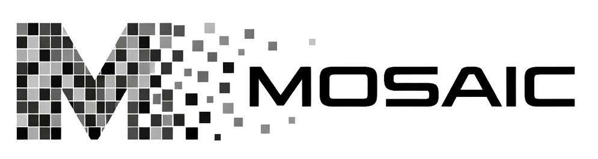

<div align="center">

<picture>
  <source media="(prefers-color-scheme: dark)"  srcset="docs/public/mosaic-logo-alpha-white.png">
  <source media="(prefers-color-scheme: light)" srcset="docs/public/mosaic-logo-alpha-black.png">
  
</picture>

#### *a vivid mosaic of open scientific literature, assembled in seconds*

### Multi-sOurce Scientific Article Indexer and Collector

> Search 22 scientific databases with one command, keep every result in a local library, and download the PDFs
> you are entitled to read. Rank, summarise, compare and question your papers with a language model on your own
> machine, or send them to Zotero, Obsidian and NotebookLM.

[](https://pypi.org/project/mosaic-search/)
[](https://github.com/szaghi/mosaic/actions/workflows/tests.yml)
[](https://szaghi.github.io/mosaic/)
[](https://www.python.org/)
[](licensing/LICENSE.gpl3.md)
[](licensing/LICENSE.bsd-2.md)
[](licensing/LICENSE.bsd-3.md)
[](licensing/LICENSE.mit.md)
[](https://t.me/mosaic_search)
[](https://t.me/mosaic_search_support)

<div>
<table>
<tr>
<td><b>🔍 Every database in one query</b><br><sub>arXiv · OpenAlex · Crossref · Semantic Scholar · PubMed · PubMed Central · Europe PMC · Cochrane · DOAJ · HAL · BASE · CORE · Zenodo · DBLP · bioRxiv/medRxiv · NASA ADS · IEEE Xplore · Springer Nature · ScienceDirect · Scopus · PEDro, searched in parallel and merged by DOI. Filters by year, author, journal, title or abstract. <a href="https://szaghi.github.io/mosaic/tutorial/01-first-search">A first search</a> · <a href="https://szaghi.github.io/mosaic/guide/sources">Sources</a></sub></td>
<td><b>📄 The PDFs you can read</b><br><sub>The source's link, every open copy Unpaywall knows (publisher, arXiv, PMC, HAL, repositories), then your saved publisher logins. Each file is checked to be a real PDF and named after the paper; a <code>.bib</code> or <code>.csv</code> of DOIs downloads in one command. <a href="https://szaghi.github.io/mosaic/tutorial/04-pdfs">Getting the PDFs</a></sub></td>
</tr>
<tr>
<td><b>🔐 Paywalls, legally</b><br><sub>Where a publisher blocks automation (Elsevier), <code>mosaic get --auto</code>
drives <em>your</em> Chrome through the same moves you would make and files each download unattended; without
Chrome, <code>mosaic get --handoff</code> opens the article in your own browser and files the PDF you download;
<code>mosaic import</code> files PDFs you already have, by their DOI. No paywall or bot-check evasion.
<a href="https://szaghi.github.io/mosaic/tutorial/05-paywalls">Paywalled papers</a></sub></td>
<td><b>🗄️ A library that grows</b><br><sub>Every result goes into a local SQLite cache that fills in what one source leaves out. Search it offline with <code>--cached</code>; export to BibTeX, RIS, CSV, JSON, Markdown, Zotero or Obsidian. <a href="https://szaghi.github.io/mosaic/tutorial/03-cache">The cache</a> · <a href="https://szaghi.github.io/mosaic/tutorial/06-exporting">Exporting</a></sub></td>
</tr>
<tr>
<td><b>📡 Following a field</b><br><sub><code>mosaic watch</code> saves searches that report only papers they have not shown you before; one cron line makes a morning digest. <code>mosaic similar</code> finds related papers from any seed. <a href="https://szaghi.github.io/mosaic/tutorial/07-following">Following a field</a></sub></td>
<td><b>🧠 A model that reads with you</b><br><sub>Relevance ranking, one-paragraph summaries that cite the rows, comparison tables, and answers from your papers with citations (<code>index</code> · <code>ask</code> · <code>chat</code>). Ollama on your machine, or OpenAI and Anthropic. <a href="https://szaghi.github.io/mosaic/tutorial/08-local-model">A local model</a> · <a href="https://szaghi.github.io/mosaic/tutorial/09-library">Asking your library</a></sub></td>
</tr>
<tr>
<td><b>🕸️ The citation map</b><br><sub>Citation links between the papers of your library, hub papers, Louvain clusters, and graph files for Gephi, Graphviz or Mermaid. <a href="https://szaghi.github.io/mosaic/tutorial/10-citations">The citation network</a></sub></td>
<td><b>🤖 Scripts, agents and a web UI</b><br><sub><code>--json</code> for jq and pipelines, exit codes that report failures, a bundled Claude Code skill, NotebookLM notebooks, and a browser interface (<code>mosaic ui</code>, or a standalone app). <a href="https://szaghi.github.io/mosaic/cookbook/scripting">Scripts and agents</a> · <a href="https://szaghi.github.io/mosaic/guide/web-ui">Web UI</a></sub></td>
</tr>
</table>
</div>

**[Full documentation](https://szaghi.github.io/mosaic/)**: [tutorial](https://szaghi.github.io/mosaic/tutorial/) · [cookbook](https://szaghi.github.io/mosaic/cookbook/) · [reference](https://szaghi.github.io/mosaic/reference/)

</div>

---

## Quick start

```bash
pipx install 'mosaic-search[all]'                 # or: pipx install mosaic-search (core only)
mosaic config --unpaywall-email you@example.org   # lets mosaic ask Unpaywall for open copies

mosaic search "hall thruster particle-in-cell"                 # every source, one table
mosaic search "hall thruster" --year 2020-2025 --oa-only -d    # filter, then download the PDFs
mosaic get --from refs.bib                                     # every DOI of a BibTeX file
mosaic get 10.1016/j.paerosci.2006.01.001 --auto              # a paywalled paper, via your Chrome
mosaic get 10.1016/j.paerosci.2006.01.001 --handoff            # a paywalled paper, via your click
mosaic search "hall thruster" --cached --output refs.bib       # the cache, as BibTeX
mosaic watch add "hall thruster anomalous transport" --name hall && mosaic watch run
```

With a language model ([Ollama](https://ollama.com) or a cloud API):

```bash
mosaic config --llm-provider openai --llm-base-url http://localhost:11434/v1 --llm-api-key ollama --llm-model qwen3:8b
mosaic search "hall thruster anomalous electron transport" --summarise
mosaic index && mosaic ask "What causes anomalous electron transport in Hall thrusters?"
```

The [tutorial](https://szaghi.github.io/mosaic/tutorial/) follows one literature search through ten chapters,
with the real output of every command. [Installation](https://szaghi.github.io/mosaic/guide/installation) lists
the extras (`rag`, `analysis`, `browser`, `ui`, `notebooklm`, `all`) and the standalone app for Windows, macOS
and Linux.

## Web UI

<div align="center">
<video src="https://szaghi.github.io/mosaic/mosaic-1.3.5-web_ui.mp4" controls width="100%"></video>
</div>

Launch with `mosaic ui` (the `ui` extra), or download the standalone app from the
[releases](https://github.com/szaghi/mosaic/releases). See the
[Web UI guide](https://szaghi.github.io/mosaic/guide/web-ui).

## Community

| | |
|---|---|
| 📢 **Announcements** | [t.me/mosaic_search](https://t.me/mosaic_search): releases, CI events, weekly digest |
| 💬 **Support group** | [t.me/mosaic_search_support](https://t.me/mosaic_search_support): questions, bug reports, discussion |

The support group has a bot that answers `/help`, `/install`, `/version`, `/docs`, `/sources`, `/changelog`,
`/bug` and `/roadmap`.

Contributions are welcome: see [Contributing](https://szaghi.github.io/mosaic/guide/contributing).

## Authors

**[Stefano Zaghi](https://github.com/szaghi)** · stefano.zaghi@gmail.com
> *Chief Yak Shaver & Accidental Package Maintainer* — Fortran programmer who needed one paper, opened 21 browser tabs, and six months later found himself maintaining a Python library

**[Andrea Giulianini](https://github.com/AndreaGiulianini)**
>*Grand Pixel Overlord & Architect of the Sacred Button* — world-class web UI designer, responsible for making MOSAIC actually look good

**[Claude](https://claude.ai)** (Anthropic)
>*Omniscient Code Oracle & Tireless Rubber Duck* — AI pair programmer, responsible for writing the boring parts so humans don't have to

## License

MOSAIC is available under your choice of license:

| License | SPDX | File |
|---|---|---|
| GNU General Public License v3 | `GPL-3.0-or-later` | [LICENSE.gpl3.md](licensing/LICENSE.gpl3.md) |
| BSD 2-Clause | `BSD-2-Clause` | [LICENSE.bsd-2.md](licensing/LICENSE.bsd-2.md) |
| BSD 3-Clause | `BSD-3-Clause` | [LICENSE.bsd-3.md](licensing/LICENSE.bsd-3.md) |
| MIT | `MIT` | [LICENSE.mit.md](licensing/LICENSE.mit.md) |

© [Stefano Zaghi](https://github.com/szaghi)
