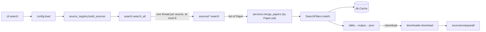

# Architecture

How the code is organised, for contributors. The package is `mosaic/`; the entry point is `mosaic.cli:app`, a
[Typer](https://typer.tiangolo.com/) application.

## A search, from the command to the cache

1. `cli.py` loads `~/.config/mosaic/config.toml` (`config.load`, the user file deep-merged over the defaults) and
   asks `source_registry.build_sources(cfg)` for one object per enabled source. A source whose key is missing
   (CORE, NASA ADS, IEEE, Springer API) reports itself unavailable and is skipped.
2. `search.search_all` queries the sources in a thread pool. Each source receives the query and the
   `SearchFilters`, and applies what its API supports natively (year ranges, field scoping, authors).
3. Results are merged by `Paper.uid` (`doi:...`, `arxiv:...`, `pii:...` or `title:...`): the first record of a
   paper is kept and its missing abstract, PDF link and DOI are filled from the later ones; the highest citation
   count wins.
4. `SearchFilters.match` filters the merged list again, for the sources that could not filter natively.
5. `cli.py` saves the papers to the cache, sorts and filters them (`services.filter_papers`,
   `services.sort_by_relevance`), prints the table or the JSON, and runs the requested actions: download, export,
   Zotero, Obsidian, summary.

A source that fails (timeout, HTTP error) does not stop the search: its error goes to the `errors` list, printed
with `--verbose` or returned in the JSON.

## Modules

### Core

| Module | Role |
|---|---|
| `cli.py` | every command and option; presentation (Rich tables, progress) |
| `models.py` | `Paper`, the data model, with `uid` and `safe_filename()`; `SearchFilters`; `fold()` for accent-insensitive name matching |
| `config.py` | reads and writes the TOML configuration; defaults; the list of known source keys |
| `source_registry.py` | `_SOURCE_REGISTRY` (config key, factory), `build_sources()`, the `--source` shorthands (`SRC_MAP`, `SHORTHAND_TO_CFG_KEY`) |
| `search.py` | `search_all()`: fan-out, merge, post-filter, per-source statistics |
| `services.py` | logic shared by the CLI and the web UI: `build_filters`, `filter_papers`, `sort_by_relevance`, `merge_papers` |
| `workflows.py` | multi-step actions shared by the CLI and the web UI: batch download, Zotero and Obsidian export |
| `db.py` | `Cache`: SQLite with papers, downloads, searches, watches, text chunks, vectors (sqlite-vec) and citation edges |
| `parsing.py` | helpers for sources: years, DOIs, HTML stripping, author name formats |
| `errors.py` | `MosaicError` and its subclasses (`SourceError`, `DownloadError`, `DependencyError`, `ConfigError`); logging setup |

### Getting PDFs

| Module | Role |
|---|---|
| `downloader.py` | `download()`: the known PDF link, then every Unpaywall location, then a saved browser session; publisher landing pages (Elsevier linkinghub to ScienceDirect) |
| `sources/unpaywall.py` | candidate open-access PDF URLs for a DOI (not a search source) |
| `pdf.py` | `is_pdf_file()`, the `%PDF` signature check that rejects HTML saved as PDF; text extraction with pymupdf |
| `auth.py` | browser sessions (Playwright): `auth login`, session health, downloads through a session, `get --interactive` |
| `handoff.py` | `get --handoff`: opens papers in your own browser and files the PDFs that appear in the download folder |
| `importer.py` | `mosaic import`: detects a PDF's DOI (metadata, ScienceDirect file name, content) and files it |
| `bulk.py` | DOIs from `.bib` and `.csv` files (`get --from`, `--from` on the library commands) |
| `cite.py` | `mosaic cite` (BibTeX locally, other styles by Crossref content negotiation); `paper_for_download()`, a paper's metadata from the cache or Crossref |

### Analysis and AI

| Module | Role |
|---|---|
| `llm.py` | the one place that calls a chat model: OpenAI, Anthropic, or any OpenAI-compatible `base_url` (Ollama, LM Studio, ...) |
| `ranking.py` | `--sort relevance`: BM25, or the LLM when one is configured |
| `summarise.py` | `search --summarise`: one paragraph over the results' titles and abstracts |
| `compare.py` | `mosaic compare`: per-paper dimensions extracted by the LLM, metadata otherwise |
| `embeddings.py` | embedding requests for the index |
| `rag.py` | `index`, `ask`, `chat`, `search --semantic`: chunking, vector retrieval, citation boost, answers |
| `citations/` | citation edges for `index --enrich-citations`: providers for OpenAlex, Crossref and OpenCitations, and the orchestrator |
| `network.py` | `mosaic network`: subgraphs, hubs, clusters (Louvain with networkx, else connected components), JSON, DOT and Mermaid export |
| `similar.py` | `mosaic similar`: OpenAlex related works and Semantic Scholar recommendations |
| `watch.py` | `mosaic watch`: saved searches and the papers each has already seen |

### Integrations and front ends

| Module | Role |
|---|---|
| `exporter.py` | `--output` formats: CSV, JSON, BibTeX, RIS, Markdown |
| `zotero.py` | Zotero local and web API client |
| `obsidian.py` | Obsidian notes |
| `notebooklm_bridge.py` | `mosaic notebook` through notebooklm-py |
| `ui/` | the Flask web UI: `routes.py`, background `jobs.py`, templates |
| `gui_launcher.py` | the standalone app's entry point (PyInstaller) |
| `data/SKILL.md` | the Claude Code skill installed by `mosaic skill install` |

### Sources

`sources/base.py` defines `BaseSource` (`name`, `search()`, `available()`) and what every source shares:
`build_field_query()` and `extract_year_range()` for the filters, and `http_client()`, an httpx client whose
`RetryTransport` retries HTTP 429 and 503 after the server's `Retry-After` (or 1 s, 2 s), at most twice, and only
when the wait is 10 s or less; `describe_http_error()` turns failures into the one-line messages users see.

| Module | Source | Module | Source |
|---|---|---|---|
| `arxiv.py` | arXiv | `hal.py` | HAL |
| `semantic_scholar.py` | Semantic Scholar | `pubmed.py` | PubMed |
| `sciencedirect.py` | ScienceDirect (API key) | `pmc.py` | PubMed Central |
| `sciencedirect_browser.py` | ScienceDirect (browser session) | `biorxiv.py` | bioRxiv and medRxiv |
| `scopus_api.py` | Scopus (API key) | `pedro.py` | PEDro (HTML) |
| `scopus_browser.py` | Scopus (browser session) | `cochrane.py` | Cochrane reviews, via Europe PMC (ISSN 1469-493X) |
| `springer_api.py` | Springer Nature (API key) | `doaj.py` | DOAJ |
| `springer_browser.py` | Springer Nature (Playwright) | `europepmc.py` | Europe PMC |
| `openalex.py` | OpenAlex | `base_search.py` | BASE |
| `crossref.py` | Crossref | `core.py` | CORE |
| `dblp.py` | DBLP | `nasa_ads.py` | NASA ADS |
| `zenodo.py` | Zenodo | `ieee.py` | IEEE Xplore |
| `custom.py` | a JSON REST API described in the configuration ([custom sources](/guide/custom-sources)) | | |

## Adding a source

1. Write `mosaic/sources/<name>.py`: a class extending `BaseSource` with a `name` and a `search(query,
   max_results, filters)` that returns `Paper` objects (set `source=self.name`). Make HTTP calls through
   `http_client()`; use `build_field_query()` and `extract_year_range()` for `--field` and `--year`.
   `sources/zenodo.py` and `sources/hal.py` are short examples.
2. Export the class from `mosaic/sources/__init__.py`.
3. In `source_registry.py`: a factory (or one of the helpers `_no_args`, `_api_key`, `_email`), an entry in
   `_SOURCE_REGISTRY`, and a shorthand in `SRC_MAP` and `SHORTHAND_TO_CFG_KEY`.
4. In `config.py`: the source's defaults under `sources` and its key in `_KNOWN_SOURCES`; add a
   `mosaic config` option if it takes an API key.
5. Tests in `tests/`, with the HTTP mocked: parsing, `available()`, the field and year filters, `raw_query`.
6. Docs: the [sources](/guide/sources) page; the `--source` help in `cli.py` lists the shorthands, and the
   [reference](/reference/search) is regenerated from it.

## Tests and docs

The tests run without network: HTTP is patched with `unittest.mock`, and `conftest.py` provides an in-memory
cache. `tests/test_docs.py` also checks the documentation: it fails when the generated command reference is stale
(`docs/scripts/gen_cli_reference.py`) or when a page shows a `mosaic` command or option that does not exist
(`docs/scripts/check_doc_commands.py`). The tutorial's outputs are real: `docs/scripts/docs_examples.py` runs the
chapters' commands against the live sources in a scratch home directory and saves what they print. See
[contributing](/guide/contributing).
