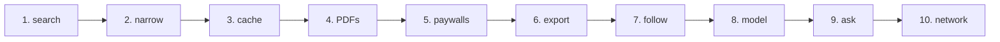

# Tutorial

The tutorial follows one literature search from the first query to a library you can question: papers on
particle-in-cell simulation of Hall thrusters, the electric engines of many satellites. Each chapter runs real
commands; the output on these pages is what they printed, captured in a fresh home directory by
[`docs/scripts/docs_examples.py`](https://github.com/szaghi/mosaic/blob/main/docs/scripts/docs_examples.py). Your
results will differ in the details: the sources answer with what they hold today.

| Chapter | You learn |
|---|---|
| [1. A first search](./01-first-search) | `mosaic search`, the results table, which sources answer |
| [2. Narrowing the results](./02-narrowing) | one source, years, title-only queries, authors, open access, sorting, per-source counts |
| [3. The local cache](./03-cache) | what mosaic remembers, searching offline, `mosaic cache` |
| [4. Getting the PDFs](./04-pdfs) | `--download`, `mosaic get`, a BibTeX file of DOIs, file names, checking the library |
| [5. Paywalled papers](./05-paywalls) | your own browser with `--handoff`, `mosaic import`, saved sessions |
| [6. Exporting](./06-exporting) | BibTeX, RIS, CSV, JSON and Markdown files, citations, Obsidian notes, Zotero |
| [7. Following a field](./07-following) | papers related to one you like, saved searches that report what is new |
| [8. A local model](./08-local-model) | relevance ranking, a summary of the results, a comparison table |
| [9. Asking your library](./09-library) | the vector index, search by meaning, questions answered from your papers |
| [10. The citation network](./10-citations) | citation edges, hub papers, clusters, a graph file |

Chapters 1–7 need only mosaic and a network connection. Chapters 8–10 use a language model and an embedding
model; the tutorial runs both on the same machine with [Ollama](https://ollama.com), and an OpenAI-compatible
server or a cloud API works the same way.

## Before you start

Install mosaic ([Installation](/guide/installation)) and check it runs:

<<< @/examples/output/01/version.txt{console}

mosaic keeps its configuration in `~/.config/mosaic/config.toml`, its cache in `~/.local/share/mosaic/cache.db`
and the PDFs in `~/mosaic-papers/`. It writes nothing else outside the folders you name.

## Then

The [Cookbook](/cookbook/) answers one task per recipe; the [Guides](/guide/sources) explain each feature in depth;
the [Reference](/reference/) lists every command and option.
